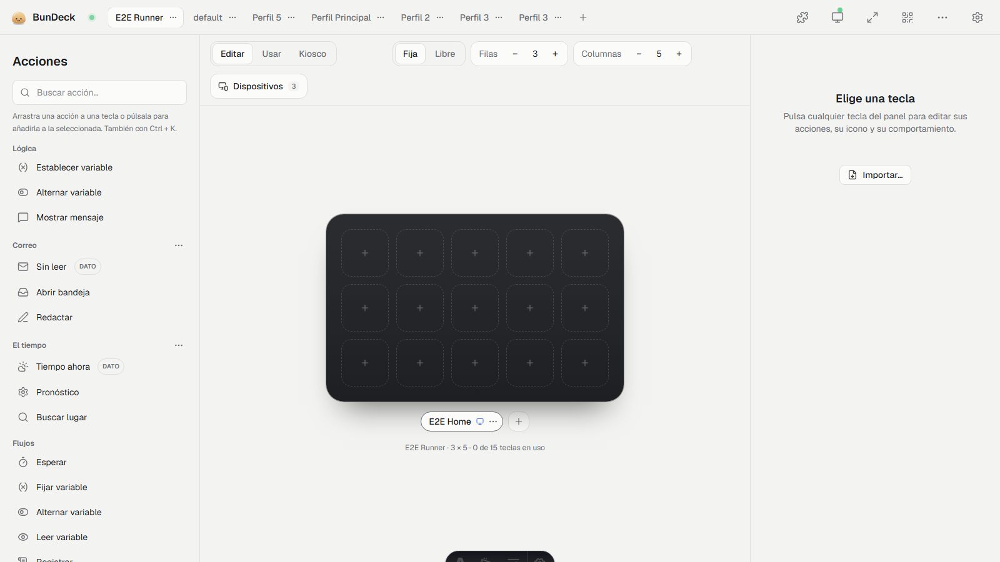

# BunDeck — Open Stream Deck Alternative

[](https://github.com/mikelgmh/BunDeck/actions)
[](https://github.com/mikelgmh/BunDeck/releases)
[](https://github.com/mikelgmh/BunDeck/issues)
[](https://opensource.org/licenses/MIT)

Automate your computer with physical or virtual buttons. Launch apps, run scripts, control OBS, Spotify, Home Assistant, media, and more—all locally, with no cloud account required.

*BunDeck está en beta: funciona para el uso diario, pero la API y los bundles gestionados aún pueden cambiar. Faltan cosas — ver [qué falta / roadmap](#status-beta--whats-missing).*

**For users:** install BunDeck, open the status window, and select **Open panel**. Start at the landing page: **[bundeck.app](https://bundeck.app)** ([features](https://bundeck.app/features)).

**For developers:** Bun daemon, Astro/Vue control panel, CLI, and native Rust launcher.


*Panel local: grid 3×5, biblioteca de acciones, inspector. Playwright `web/tests/e2e/`.*

## Download BunDeck

Choose your platform. These links always resolve to the latest release.

| Windows | macOS | Linux |
|---|---|---|
| **Windows installer**<br>Daemon, CLI, launcher, and panel<br>[**Download BunDeck-Setup.exe**](https://github.com/mikelgmh/BunDeck/releases/latest/download/BunDeck-Setup.exe) | **Managed bundle · x64**<br>Install with `scripts/install-macos.sh`<br>[**View latest macOS download**](https://github.com/mikelgmh/BunDeck/releases/latest) | **Managed bundle · x64**<br>Install with `scripts/install-linux.sh`<br>[**View latest Linux download**](https://github.com/mikelgmh/BunDeck/releases/latest) |

> macOS and Linux downloads are managed bundles rather than native installers. See [installation notes](#installation) for setup details and [the latest release](https://github.com/mikelgmh/BunDeck/releases/latest) for the platform bundles.

## Contents

1. [Downloads](#download-bundeck)
2. [In 60 seconds](#in-60-seconds)
3. [Architecture](#architecture-why-each-piece)
4. [Measured footprint](#measured-footprint--comparison)
5. [Installation](#installation)
6. [Daily use](#daily-use)
7. [Ports, bind and data](#ports-bind-and-data)
8. [Remote access & relay privacy](#remote-access--relay-privacy)
9. [CLI](#cli-bundeck-cli)
10. [API and WebSocket](#api-and-websocket)
11. [Plugins](#plugins)
12. [Development](#development)
13. [Build and release](#build-and-release)
14. [Status (beta) & what's missing](#status-beta--whats-missing)
15. [Environment variables](#environment-variables)
16. [Troubleshooting](#troubleshooting)
17. [FAQ](#faq-why-not-electron)

---

## In 60 seconds

```bash
# 1) Download the installer from Releases and install it
# 2) Open BunDeck (status window) → “Open panel”
# 3) Create a button and assign an action. That’s it.
```

The panel is a local website (`http://localhost:3002` in prod, `:4321` in dev). You can also open it from your phone on the same Wi-Fi using the LAN IP shown in the status window.

---

## Architecture: why each piece

```
┌─────────────────┐      HTTP :3001 / WS :3003      ┌──────────────────┐
│  Web panel       │ ◄────────────────────────────► │  Daemon (Bun)     │
│  Astro + Vue     │   API + live events            │  SQLite + plugins │
│  (your browser)  │                                │  + Stream Deck HW │
└─────────────────┘                                └────────▲──────────┘
                                                           │ spawn / shutdown
                                                  ┌────────┴──────────┐
                                                  │ Rust/GPUI launcher │
                                                  │ window + tray      │
                                                  │ lifecycle owner    │
                                                  └───────────────────┘
```

| Piece | What it is | Why it is shaped this way |
|---|---|---|
| **Daemon** (`daemon/`, Bun + SQLite) | Owns data, actions, plugins, hardware and the API/WS. | A single source of truth process: closing the window never stops automation. Bun starts fast, sips memory and compiles to a single `.exe` with `bun build --compile`. |
| **Web panel** (`web/`, Astro + Vue) | Control UI only. | Runs in your browser: zero cost of an embedded Chromium. Astro builds a tiny static site (~1.3 MB). Vue only where there is interactivity. |
| **Launcher** (`launcher/`, Rust + GPUI) | Status window + tray. Starts, watches and stops the daemon. | XAMPP-style: a minimal native panel that is always there without loading a web view. In prod it is the **only** lifecycle owner — no double spawn, no double icon. |
| **CLI** (`cli/`, Bun) | API client + process manager. | For scripting and headless admin: `start/stop/status/plugin/logs`. No duplicated logic: everything goes through the same API as the panel. |
| **Electrobun** (`src/bun/`, dev-only) | Native window host using the OS WebView. | Handy for development and experiments. Out of the canonical release: in prod it adds another resident process for no real benefit. |

Deliberate choices:

- **No double supervisor:** either the launcher starts the daemon, or you do. Never both (`BUNDECK_MANAGED`, pre-flight health check).
- **Single tray:** the GPUI launcher owns the only tray icon (`launcher/src/tray.rs`). The daemon has no tray code at all — no double icons, not even in dev.
- **One shutdown path:** `POST /api/v1/admin/shutdown` → `lifecycle.ts` → stops API, frontend, WS and tray in order. CLI, launcher and host all request the same thing.
- **One contract:** the API lives under `/api/v1`. CLI and panel use the same endpoints.

---

## Measured footprint + comparison

Measured in this repo on a 64-bit desktop OS at idle (resident set size):

| Component | Idle RAM | Disk size | Notes |
|---|---|---|---|
| Daemon `bun run daemon/src/server.ts` | **~55 MB** | — | Dev, SQLite + native plugins loaded |
| Compiled daemon `bundeck-daemon` | **~46 MB** | **~138 MB** | Includes Bun runtime + SQLite + natives; less RAM than dev (`.exe` on Windows, no extension on macOS/Linux) |
| Launcher `bundeck-launcher` (release) | **~54 MB** with window | **~6.5 MB** | Native GPUI, 2 s polling (`.exe` on Windows) |
| Compiled CLI | short-lived (only while running) | **~110 MB** | Not resident |
| Panel `web/dist` | 0 (lives in your browser) | **~1.3 MB**, 10 files | Static Astro output |

**Prod total at idle: ~100 MB** (daemon 46 + launcher 54). The panel adds no process of its own.

### Against an equivalent Electron app

|  | BunDeck | Typical Electron |
|---|---|---|
| UI engine | Your browser or the OS WebView (shared) | **Per-app embedded Chromium** + its own Node |
| Idle processes | 2 (daemon + launcher) | 4–7 (main + one renderer per window + GPU + helpers) |
| Indicative idle RAM | **~100 MB** measured | **~250–500 MB** for an app with window + backend |
| Binary | Daemon 138 MB + launcher 6.5 MB + web 1.3 MB | Electron app 80–150 MB + Chromium data |
| Startup | Bun in ms, native Rust | Cold Chromium startup |

Why Electron costs more: every app ships its own Chromium even if Chrome/Edge is already installed, and every window is a full renderer with its own JS heap, compositor and often a GPU process. For a panel that stays closed 90% of the time and a backend that must always be alive, paying for a resident Chromium makes no sense. BunDeck splits both concerns: an always-on cheap backend (Bun), on-demand UI (browser) and minimal native control (Rust).

> Honest note: Electron figures are typical ecosystem ranges, not a measurement of a clone of ours. BunDeck figures are measurements from this repo (see table). To reproduce, let the stack idle for 1 min with the same `BUNDECK_DATA_DIR` and compare (`Get-Process` on PowerShell, `ps -o pid,rss,comm -p <pid>` on macOS/Linux).

What about Electrobun? It uses the OS WebView (WebView2 on Windows, WebKit on macOS, WebKitGTK on Linux), far lighter than embedded Chromium. Even so, in prod it would be a third resident process just to wrap the panel. Since the panel already opens fine in the browser and the launcher covers status/tray/updates, Electrobun stays **dev-only**. Fewer processes = less RAM and fewer things that can break.

---

## Installation

BunDeck is cross-platform: **Windows, macOS and Linux** are first-class citizens. Pick your OS below — every link always points at the latest release.

**Requirements: nothing to install.** Every bundle ships self-contained binaries (the Bun runtime is compiled in) — no Node, Bun, or admin rights needed. Windows installs per-user; macOS/Linux install scripts default to your home directory (`~/.local/share/bundeck`, `~/Applications/BunDeck`).

The latest platform downloads are at the top of this README. The [latest release](https://github.com/mikelgmh/BunDeck/releases/latest) contains the installers, managed bundles, and update manifest.

**Supported Stream Deck hardware:** Mini, Original/Classic, MK.2, XL and Plus families (6/15/32-key layouts), detected automatically via `@elgato-stream-deck/node`. No hardware? The browser panel is a fully virtual deck.

### Per-OS notes

- **Windows:** run the installer, open **BunDeck** → **Open panel**. It installs in your user profile (no administrator permission needed) and sets up daemon + CLI + launcher + panel. A system tray icon is available (Windows-only).
- **macOS:** run the installer script from Terminal: `curl -fsSLO https://raw.githubusercontent.com/mikelgmh/BunDeck/master/scripts/install-macos.sh && bash install-macos.sh`. It downloads and verifies the latest managed bundle. You can also download the bundle from the latest release page linked above.
- **Linux:** run `curl -fsSLO https://raw.githubusercontent.com/mikelgmh/BunDeck/master/scripts/install-linux.sh && bash install-linux.sh`. It downloads and verifies the latest managed bundle. You can also download the bundle from the latest release page linked above.

> **Honest installer note:** the install scripts verify the bundle's **sha256 integrity only, not authorship** — a matching hash proves the download wasn't corrupted, not who built it. Authorship **is** verified where it matters: the launcher's updater checks an Ed25519 signature on every bundle before applying it (see `UPDATE_SYSTEM.md` and `SECURITY.md`). Verifying that signature inside a plain `bash` script isn't cleanly feasible (no Ed25519 in coreutils or the Python stdlib), so the scripts deliberately stay integrity-only.
>
> **Antivirus false positives:** the binaries are built with `bun build --compile`, which bundles a runtime the way packers do — some AV heuristics flag that. If your AV quarantines a BunDeck binary, allow-list it; the hash in the release manifest lets you confirm the file is intact.
>
> **LAN / firewall:** everything works on loopback with no firewall changes. Opening the panel from your phone needs LAN bind (`BUNDECK_BIND_LAN=1`, set automatically by the launcher) **and** allowing the frontend port (`3002`) through your OS firewall on private networks.

### Updates

Managed installs (installer or install script) update from the launcher:
the launcher checks automatically at startup and periodically, then downloads
and verifies updates in the background. When ready, **Reiniciar para actualizar**
installs the staged version; if left pending, it is applied on the next launch.
Updates include database backup and automatic rollback.
Standalone binaries: `bundeck-cli update` (see `UPDATE_SYSTEM.md`).

### From source

```bash
git clone https://github.com/mikelgmh/BunDeck.git
cd BunDeck
bun run install:all   # daemon+cli with bun, web with npm (on purpose)
bun run dev           # daemon + Astro panel + launcher
```

---

## Daily use

- **Open panel:** button in the status window or `http://localhost:3002` (prod) / `http://localhost:4321` (dev). Same on Windows, macOS and Linux.
- **Phone on LAN:** use the IP shown by the launcher, e.g. `http://192.168.1.20:3002`.
- **Quit:** “Quit” in the status window (tray menu on Windows). Stops daemon + window in order.
- **Physical Stream Deck:** plug it in and the daemon picks it up (a failed init never crashes the daemon).

---

## Ports, bind and data

| Service | Default | Override |
|---|---|---|
| API | `3001` | `PORT` or `--port=` |
| WebSocket | `3003` | `WS_PORT` |
| Embedded frontend | `3002` | `FRONTEND_PORT` or `--web-port=` |
| Astro dev | `4321` | `astro.config.mjs` |
| Launcher API (127.0.0.1 only) | `3031` | `HOST_PORT` |

Secure by default:

- The daemon listens on **`127.0.0.1`**. For LAN (phone/QR): `BUNDECK_BIND_LAN=1` or `BUNDECK_BIND=0.0.0.0`. `dev.sh`, the Rust launcher and the dev host already set it when needed.
- CORS never uses `*` with credentials: it echoes `Origin` only when local (`localhost`, `127.0.0.1`, `::1`, `10/8`, `172.16/12`, `192.168/16`).
- `POST /api/v1/admin/shutdown` is local by design; don’t expose it to WAN.

Data (`daemon/src/config.ts:resolveDataDir`):

```
BUNDECK_DATA_DIR > ELECTROBUN_DATA_DIR/bundeck > %APPDATA%/BunDeck/data (installed) > <repo>/data (dev)
```

That holds `db.sqlite`, `assets/`, `plugins/` and `logs/`. `data/` is local state: never committed.

---

## Remote access & relay privacy

Your phone can drive BunDeck from outside your LAN through the public relay — **end-to-end encrypted, P2P when possible**:

- **Default relay:** `wss://relay.bundeck.app` (no setup needed). The old host `wss://bundeck.mikelgranero.com` still works as a fallback.
- **What the relay operator can see:** routing metadata only — which device IDs are online, IPs, connection times, message sizes/timing. **Never message contents:** payloads are NaCl `box` envelopes (X25519 + XSalsa20-Poly1305) the relay forwards opaquely and cannot decrypt. Self-host it if you prefer (`relay/` + `relay/docker-compose.example.yml`).
- **P2P:** once peers establish a direct channel, traffic never passes through the relay at all.
- **Disable it:** set `remote.relay.url` to `off` (also accepts `none` / `disabled`). Local and LAN features keep working.

Only the invitation-redeem endpoint is rate-limited (anti-scan); the local API is throttle-free by design on loopback. Full model: [`SECURITY.md`](SECURITY.md).

---

## CLI `bundeck-cli`

```bash
bundeck-cli start --detach        # background (pidfile + log under data/)
bundeck-cli status               # API + WS (discovers WS via /config → /health)
bundeck-cli stop                 # 1) API shutdown 2) pidfile 3) targeted kill by PID
bundeck-cli plugin list
bundeck-cli plugin install ./my-plugin        # local folder
bundeck-cli plugin install ./my-plugin.zip    # local zip (upload)
bundeck-cli plugin install https://github.com/org/plugin.git --ref v1.2.0
bundeck-cli logs -n 50 --level error
bundeck-cli logs --follow        # live WS (logs topic), falls back to 2 s polling
```

The CLI is just another client: it never touches the DB directly, everything goes through `http://localhost:<port>/api/v1`.

---

## API and WebSocket

Base: `http://localhost:3001`. Health: `GET /health` → `{ status, timestamp, version, websocket }`. UI config: `GET /config` → `{ wsPort, apiPort, frontendPort }`.

Main families (`daemon/src/api/*.ts`, `routes.ts` only dispatches):

```
GET/POST /api/v1/profiles   GET/PUT/DELETE /api/v1/profiles/:id
GET/POST /api/v1/pages?profileId= ...
GET/PUT/DELETE /api/v1/pages/:id   GET/POST/PUT/DELETE /api/v1/buttons...
POST /api/v1/actions/execute
GET /api/v1/plugins  POST /api/v1/plugins/install  POST /api/v1/plugins/upload
GET /api/v1/devices/streamdeck/*   GET /api/v1/network/ips
GET /api/v1/logs  GET/POST /api/v1/settings  GET /api/v1/mcp/*  GET /api/v1/jobs
POST /api/v1/admin/shutdown
GET /api/v1/version
```

WebSocket `ws://localhost:3003`:

- Client → `subscribe` / `unsubscribe` / `button.press` / `page.select` / `profile.select`
- Server → `button.pressed`, `action.started/finished/error`, `profile.updated/navigate`, `page.created/updated/deleted/navigate`, `button.updated/deleted`, `plugin.installed/enabled`, **`log.created`** (`logs` topic)

---

## Plugins

- Native: create `daemon/src/plugins/my.plugin.ts`, export it from `daemon/src/plugins/index.ts`. It self-installs with versioning and respects `enabled`.
- External: folder under `<data>/plugins/<id>/` with `manifest.json` + `main.js` (`register(api)` / `onAction` / `emitEvent`). Validation in `plugin-system/validator.ts`, sandbox in `sandbox.ts`.

Install a local folder without zipping:

```bash
bundeck-cli plugin install ./my-plugin --force
# same as POST /api/v1/plugins/install { sourceType:'directory', path:'<abs>' }
```

---

## Development

```bash
bun run install:all
bun run dev              # daemon (DEV_MODE) + Astro + launcher
./dev.sh setup           # first time: deps + data/ + profile + example plugin
./dev.sh dev             # dev with LAN detection + auto-open

cd daemon && bun test    # 236 tests
cd cli && bun test       # 30 tests
bun test src/bun/        # 46 tests
cd web && npm run test   # vitest
```

Repo rules (`AGENTS.md` wins):

- Use `DatabaseService` (`daemon/src/db.ts`), never raw SQL. `data` columns are JSON-as-TEXT: parse at the boundary.
- New routes go in `daemon/src/api/<family>.ts`, not in the dispatcher.
- Web with **npm**, daemon/CLI with **bun**. Don’t mix them.
- Don’t start dev servers unless asked: the user already has them running.

---

## Build and release

Canonical prod = **Rust launcher + compiled daemon + web-dist**:

```bash
./build.sh
# web → daemon/web-dist + dist/ → compiled daemon+cli (version embedded)
# → Rust launcher + updater (if cargo exists) → managed bundle per OS
# (Windows: Inno Setup installer; macOS/Linux: bundle + install scripts)
```

- Single version source: root `package.json`. Daemon/CLI read it from `*/src/version.ts` (`BUNDECK_VERSION` > embedded root JSON > `dev`). `/health` and `/api/v1/version` (now `{ version, channel: 'stable', buildDate }`) use `getVersion()`, no hardcoded `0.1.0`. Launcher version comes from `build.rs` (`BUNDECK_VERSION` or root JSON).
- CI (`.github/workflows/release.yml`): test → per-OS build (daemon + CLI + launcher + updater + `web-dist` → `bundeck-v<ver>-<target>.zip`; Windows also `BunDeck-Setup`) → manifest (`scripts/build-update-manifest.mjs`, signed with `LIBREDECK_UPDATE_PRIVKEY` secret) → `semantic-release` on `master`.
- Auto-update owner is the launcher (`launcher/src/updater.rs`, details in `UPDATE_SYSTEM.md`). Electrobun stays out of the canonical release.

---

## Status (beta) & what's missing

BunDeck is in **beta**: it works for daily use, but expect rough edges, changing APIs, and gaps. Concretely:

- Managed bundles for macOS/Linux instead of native installers; macOS builds aren't notarized yet (one-time Gatekeeper approval per version).
- Remote access and the internet-exposed UI tunnel are functional but young — review [`SECURITY.md`](SECURITY.md) before exposing anything beyond your LAN.
- Plugin ecosystem is small; external-plugin sandboxing exists but **treat external plugins as arbitrary code**.

What's next is tracked in the open: **[roadmap & issues](https://github.com/mikelgmh/BunDeck/issues)** — feature requests and bug reports are welcome there.

**No telemetry, ever.** BunDeck collects nothing: no analytics, no crash reports, no phone-home. The only network traffic is what you trigger (updater manifest/release checks, relay traffic when remote access is enabled).

---

## Environment variables

| Var | Effect |
|---|---|
| `PORT` / `WS_PORT` / `FRONTEND_PORT` / `HOST_PORT` | Ports (see table) |
| `DEV_MODE=true` | No embedded frontend; UI on Astro `:4321` |
| `BUNDECK_DATA_DIR` | Explicit data dir (also tests) |
| `BUNDECK_INSTALL_DIR` | Managed install root (updater layout); defaults to launcher dir |
| `BUNDECK_BIND` / `BUNDECK_BIND_LAN=1` | `0.0.0.0` for LAN; loopback by default |
| `BUNDECK_VERSION` | Version override (build/CI inject it) |
| `BUNDECK_UPDATE_PUBKEY` | Update signing pubkey override (else compiled `UPDATE_PUBKEY`) |
| `BUNDECK_MANAGED=1` | Daemon skips self-management (set by launcher) |
| `BUNDECK_HOST_MANAGE_DAEMON=0/1` | Forbid/force Electrobun daemon management |
| `BUN_PATH` | Alternate bun for the dev host |
| `NO_LAUNCHER=1` / `NO_BROWSER=1` | Don’t open launcher / browser in dev |

---

## Troubleshooting

| Symptom | Likely cause | Fix |
|---|---|---|
| Panel won’t open on `:3002` | Daemon in `DEV_MODE` or busy port | In dev use `:4321`; check `http://localhost:3001/health` and `HOST_PORT` |
| Phone can’t reach panel | Loopback bind without LAN | Start with `BUNDECK_BIND_LAN=1` (dev.sh/launcher already do) |
| Folder `plugin install` fails | Relative path or missing `manifest.json` | Pass an absolute path with `manifest.json` + `main.js`; the CLI already absolutizes it |
| Old DB with odd version | Stale `app.version` | Self-heals on boot (`getVersion()`); otherwise `./dev.sh clean` |
| Busy port | Another daemon running | `bundeck-cli status` / `stop`, or change `PORT`/`WS_PORT` |

Logs: `bundeck-cli logs --follow` or `<data>/logs/daemon.log` (detached mode).

---

## FAQ: why not Electron

**Wasn’t Electron easier?**
Easier to package, yes. But you would pay for a full resident Chromium for a panel that stays closed and a backend that must stay tiny. Measured here: ~100 MB full stack vs 250–500 MB typical for an equivalent Electron app.

**Why Bun instead of Node?**
Instant startup, built-in SQLite and WS without fragile natives, and `bun build --compile` yields a single binary with no runtime installer (`.exe` on Windows, no extension on macOS/Linux).

**Why Astro + Vue instead of a React SPA?**
The panel is 90% static + interactive islands. Astro outputs 1.3 MB of static files; Vue only where state lives (buttons, inspector, streaming). Less JS = less RAM in the browser.

**Why Rust for the launcher?**
Because its job is minimal and always resident: watch 3 ports, show status, request shutdown. In Rust that is a 6.5 MB binary and ~54 MB with window. In Electron it would be hundreds of MB for the same job.

**So what is Electrobun for?**
Good tech (OS WebView, not embedded Chromium) and handy in dev. But in prod it duplicated the launcher role. One process less, one problem less.
